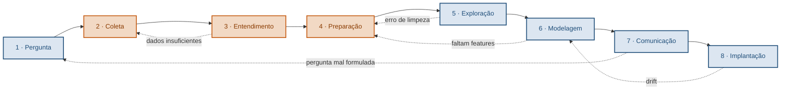

# O Pipeline de Ciência de Dados

> Material de referência — Aula 1
> Programação para Ciência de Dados

---

## 1. Em uma frase

Todo projeto de ciência de dados percorre a mesma sequência de etapas — da formulação da pergunta até a comunicação do resultado — e o valor do trabalho depende muito mais das etapas intermediárias, invisíveis, do que da modelagem, que é a parte visível.

O processo tem vários nomes na literatura: **CRISP-DM** (o mais antigo e citado, de 1999), **OSEMN**, **ciclo de vida do dado**. Todos descrevem essencialmente o mesmo caminho, com granularidade diferente.

---

## 2. As oito etapas

| # | Etapa | A pergunta que ela responde | Entrega |
|---|---|---|---|
| 1 | Pergunta | Que problema estamos resolvendo, e como saberemos que resolvemos? | Perguntas respondíveis + critério de sucesso |
| 2 | Coleta | De onde vêm os dados? | Dataset bruto |
| 3 | Entendimento | O que existe aqui? Dá para confiar? | Diagnóstico dos dados |
| 4 | Preparação | Como corrigir, completar e transformar? | Dataset analisável |
| 5 | Exploração | Que padrões e relações existem? | Hipóteses e evidências visuais |
| 6 | Modelagem | É possível prever, classificar ou agrupar? | Modelo avaliado |
| 7 | Comunicação | O que isso significa para quem decide? | Recomendação e limitações |
| 8 | Implantação | Como colocar em uso e manter funcionando? | Sistema em produção monitorado |

---

## 3. Detalhamento por etapa

### Etapa 1 — Pergunta

Traduzir um desejo de negócio em perguntas que dados conseguem responder.

- **Entrada:** demanda de negócio, geralmente vaga
- **Saída:** perguntas específicas + definição de sucesso
- **Atividades:** entrevista com stakeholders, delimitação de escopo, definição de métrica
- **Falha característica:** responder com precisão uma pergunta que ninguém fez
- **Onde aprofundamos:** aulas 7 e 11

> "Queremos reduzir desistências no app" não é uma pergunta de dados. "Exibir estimativa de preço antes da corrida reduz a taxa de abandono?" é.

### Etapa 2 — Coleta

Obter os dados, de onde quer que estejam.

- **Entrada:** perguntas definidas
- **Saída:** dataset bruto, com procedência documentada
- **Ferramentas:** `pandas.read_csv`, `read_sql`, SQLAlchemy, `requests`, BeautifulSoup, APIs
- **Falha característica:** amostra enviesada — os dados não representam a população sobre a qual se quer concluir
- **Onde aprofundamos:** aula 10

### Etapa 3 — Entendimento

Descobrir o que há nos dados antes de tocar neles. Também chamado de *profiling*.

- **Entrada:** dataset bruto
- **Saída:** diagnóstico — dimensões, tipos, ausências, distribuições, anomalias
- **Ferramentas:** `df.info()`, `df.describe()`, `df.isna().sum()`, `value_counts()`, histogramas rápidos
- **Falha característica:** não perceber que faltam dados, ou que faltam de forma **sistemática** (o que é muito pior que faltarem ao acaso)
- **Onde aprofundamos:** aula 4

### Etapa 4 — Preparação

A etapa mais longa e a menos comentada.

- **Entrada:** dataset bruto + diagnóstico
- **Saída:** dataset analisável
- **Atividades:** tratar ausências, corrigir tipos, normalizar texto, remover duplicatas, tratar outliers, derivar colunas, unir tabelas
- **Ferramentas:** `dropna`, `fillna`, `astype`, `.str`, `.dt`, `merge`, `groupby`
- **Falha característica:** descartar como "outlier" justamente o fenômeno de interesse
- **Onde aprofundamos:** aulas 5 e 6

> Toda decisão de limpeza é uma decisão de negócio disfarçada de decisão técnica. Descartar uma linha é afirmar que ela não representa o fenômeno estudado — e isso precisa ser justificável.

### Etapa 5 — Exploração

Procurar padrões, relações e estrutura. Análise exploratória de dados (EDA).

- **Entrada:** dataset limpo
- **Saída:** hipóteses sustentadas por evidência
- **Atividades:** agregações, correlações, distribuições, segmentação, visualização exploratória
- **Ferramentas:** `groupby`, `corr`, matplotlib, seaborn
- **Falha característica:** confundir correlação com causalidade
- **Onde aprofundamos:** aulas 7, 8 e 9

### Etapa 6 — Modelagem

Construir algo que generalize para dados novos.

- **Entrada:** dataset preparado, com features definidas
- **Saída:** modelo treinado e avaliado honestamente
- **Atividades:** separar treino/teste, escolher algoritmo, treinar, avaliar, ajustar hiperparâmetros
- **Ferramentas:** scikit-learn (`train_test_split`, `fit`, `predict`, `Pipeline`, `GridSearchCV`)
- **Falha característica:** **vazamento de dados** — o modelo vê, durante o treino, informação que não estaria disponível no momento da previsão real. A métrica fica excelente e o modelo é inútil.
- **Onde aprofundamos:** aulas 12 a 16

### Etapa 7 — Comunicação

Traduzir resultado técnico em decisão possível.

- **Entrada:** modelo e achados
- **Saída:** recomendação, com limitações explícitas
- **Atividades:** selecionar o que importa, escolher visualizações, escrever para o público certo, declarar o que o trabalho **não** sustenta
- **Falha característica:** gráfico bonito que induz à decisão errada
- **Onde aprofundamos:** aulas 9 e 17

### Etapa 8 — Implantação e monitoramento

Fora do notebook.

- **Entrada:** modelo aprovado
- **Saída:** sistema em produção, monitorado
- **Atividades:** serialização, API, versionamento, monitoramento de *drift*, retreinamento
- **Falha característica:** publicar e esquecer — todo modelo se degrada conforme a realidade se afasta dos dados de treino
- **Onde aprofundamos:** aula 17

---

## 4. O pipeline não é linear

Representar as etapas em fila sugere uma esteira. Não é. Os retornos são constantes e **fazem parte do método**, não são sinal de má execução.

Os retornos mais comuns:

| De | Para | Motivo |
|---|---|---|
| 3 · Entendimento | 2 · Coleta | Dados insuficientes ou coluna essencial ausente |
| 5 · Exploração | 4 · Preparação | Um erro de limpeza só aparece no gráfico |
| 6 · Modelagem | 4 · Preparação | O modelo tem desempenho ruim; faltam features |
| 6 · Modelagem | 2 · Coleta | Volume de dados insuficiente para generalizar |
| 7 · Comunicação | 1 · Pergunta | A pergunta original se revela mal formulada |
| 8 · Implantação | 6 · Modelagem | *Drift*: o desempenho cai com o tempo |

> Notebooks publicados e artigos apresentam sequências que funcionam de primeira, porque foram escritos depois de prontos. Nenhum foi construído assim. Análise limpa é resultado, não método.

---

## 5. Onde o tempo realmente vai

| Etapas | Fatia típica do esforço |
|---|---|
| 1 · Pergunta | 5–10% |
| 2–4 · Coleta, entendimento e preparação | **60–80%** |
| 5 · Exploração | 10–15% |
| 6 · Modelagem | 5–10% |
| 7 · Comunicação | 5–10% |

A modelagem, que é a parte glamourosa e a que ocupa a maior parte dos cursos, costuma ser a mais curta. A qualidade do resultado final é determinada muito mais pelas etapas 2 a 4.

---

## 6. Falhas características — resumo

| Etapa | Falha | Consequência |
|---|---|---|
| 1 · Pergunta | Responder o que ninguém perguntou | Trabalho tecnicamente correto e inútil |
| 2 · Coleta | Amostra enviesada | Conclusão não generaliza |
| 3 · Entendimento | Ignorar ausência sistemática | Viés silencioso em tudo o que vem depois |
| 4 · Preparação | Descartar o fenômeno como outlier | Perda justamente do que importava |
| 5 · Exploração | Correlação lida como causalidade | Recomendação errada com aparência de rigor |
| 6 · Modelagem | Vazamento de dados | Métrica excelente, modelo inútil em produção |
| 7 · Comunicação | Visualização enganosa | Decisão errada, tomada com confiança |
| 8 · Implantação | Publicar e esquecer | Degradação silenciosa ao longo do tempo |

---

## 7. Diagrama (Mermaid)

As três etapas destacadas em laranja concentram 60–80% do esforço.

---

## 8. Especificação para gerar a visualização

Cole o que segue na ferramenta de sua preferência.

**Objetivo:** diagrama de slide, formato paisagem 16:9, projetável.

**Elementos obrigatórios:**

1. Sete caixas numeradas em sequência horizontal, ligadas por setas sólidas: Pergunta → Coleta → Entendimento → Preparação → Exploração → Modelagem → Comunicação. Uma oitava caixa (Implantação) visualmente destacada como fora do escopo do notebook — borda tracejada ou tom mais claro.
2. Cada caixa com o número, o nome da etapa e uma linha curta de descrição.
3. **Setas de retorno**, tracejadas e em cor contrastante, mostrando os cinco ciclos: Entendimento→Coleta, Exploração→Preparação, Modelagem→Preparação, Comunicação→Pergunta, Implantação→Modelagem. Devem ser visualmente secundárias em relação ao fluxo principal, mas legíveis — a mensagem é que o processo é cíclico.
4. Destaque visual sobre as etapas 2, 3 e 4 com o rótulo "60–80% do esforço".

**Diretrizes de estilo:** paleta sóbria de duas cores mais neutros; alto contraste para projeção; tipografia sem serifa; sem ícones decorativos; sem gradientes. Legibilidade a 5 metros de distância é o critério.

**O que evitar:** empilhar as setas de retorno de forma que se cruzem; texto abaixo de 14pt no tamanho final; mais de duas cores de destaque.

---

## 9. Para levar

1. O pipeline é o mapa. Em qualquer momento de um projeto, saber em que etapa você está determina o que fazer a seguir.
2. Ele é cíclico. Voltar atrás é o funcionamento normal do trabalho.
3. O esforço se concentra onde ninguém olha: coleta, entendimento e preparação.
4. Cada etapa tem um modo característico de falhar, e conhecê-los antecipadamente é a defesa mais barata que existe.
5. As 17 aulas seguintes desta disciplina são o aprofundamento de uma etapa cada.
